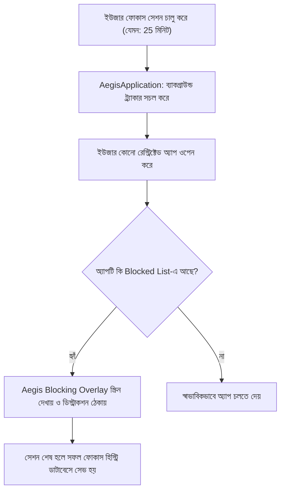

# 🛡️ ASR / Aegis-Focus — সম্পূর্ণ কোডবেজ গাইড ও বিশ্লেষণ (Code Guide)

স্বাগতম! এই গাইডটি **ASR / Aegis-Focus** প্রোডাক্টিভিটি স্যুট এবং অ্যান্ড্রয়েড অ্যাপের সমস্ত আর্কিটেকচার, ব্যাকগ্রাউন্ড সার্ভিস ও ব্লকিং মেকানিজম সহজে বোঝার জন্য তৈরি করা হয়েছে।

---

## 🗺️ ১. আর্কিটেকচার ও ফাইল মানচিত্র (File & Architecture Map)

| ফাইল পাথ | মূল ভূমিকা | কী কাজ করে? |
| :--- | :--- | :--- |
| [`about.html`](file:///Users/khalidabdullah/AntiGravity/aegis-focus/about.html) | **ওয়েব ল্যান্ডিং পেজ** | ASR ফিলোসফি ও ব্র্যান্ড শোকেস (Time, Attention, Discipline)। |
| [`AegisApplication.kt`](file:///Users/khalidabdullah/AntiGravity/aegis-focus/app/src/main/java/com/aegisfocus/app/AegisApplication.kt) | **অ্যাপ এন্ট্রি পয়েন্ট** | নোটিফিকেশন চ্যানেল তৈরি ও ব্যাকগ্রাউন্ড `WorkManager` শুরু করে। |
| [`AegisNavHost.kt`](file:///Users/khalidabdullah/AntiGravity/aegis-focus/app/src/main/java/com/aegisfocus/app/core/navigation/AegisNavHost.kt) | **UI নেভিগেশন গ্রাফ** | Home, Focus, Apps, Stats এবং Settings স্ক্রিনের রাউটিং নিয়ন্ত্রণ করে। |
| [`TimeUtils.kt`](file:///Users/khalidabdullah/AntiGravity/aegis-focus/app/src/main/java/com/aegisfocus/app/core/common/TimeUtils.kt) | **টাইমার ইউটিলিটি** | সেশনের বাকি সময় (যেমন: 25:00) ও মোট ঘণ্টার হিসাব প্রদর্শন করে। |
| [`AegisDatabase.kt`](file:///Users/khalidabdullah/AntiGravity/aegis-focus/app/src/data/local/AegisDatabase.kt) | **লোকাল ডাটাবেস (Room)** | ব্লকড অ্যাপস তালিকা ও ফোকাস হিস্ট্রি সংরক্ষণ করে। |

---

## 🔄 ২. ব্লকিং ও ফোকাস সেশনের ওয়ার্কফ্লো (Focus Lifecycle)

---

## 🔍 ৩. গুরুত্বপূর্ণ কম্পোনেন্ট বিশ্লেষণ (Core Components Deep Dive)

### ক. `AegisApplication.kt`
- 📌 **উদ্দেশ্য:** অ্যাপ ওপেন হওয়ার সাথে সাথে গ্লোবাল ইনিশিয়ালাইজেশন নিশ্চিত করা।
- ⚙️ **লজিক ফ্লো:**
  1. `AppContainer` ইনিশিয়ালাইজ করে ডিপেন্ডেন্সি ইনজেকশন নিশ্চিত করে।
  2. হাই-প্রায়োরিটি নোটিফিকেশন চ্যানেল তৈরি করে (যাতে ফোকাস চলাকালে টাইমার দেখা যায়)।
  3. `DailyUsageSnapshotWorker` এবং `ScheduleCheckWorker` ব্যাকগ্রাউন্ড টাস্ক শিডিউল করে।

### খ. `TimeUtils.kt`
- 📌 **উদ্দেশ্য:** সময়কে মানুষের পড়ার উপযোগী ফরম্যাটে আনা।
- ⚙️ **লজিক:**
  - `formatRemainingMillis(1500000)` $\rightarrow$ `"25:00"`
  - `formatMinutesHuman(150)` $\rightarrow$ `"2h 30m"`

---

## 🛠️ ৪. কীভাবে টেস্ট ও বিল্ড করবেন (Build & Test)
১. অ্যান্ড্রয়েড স্টুডিও (Android Studio)-তে `aegis-focus` ফোল্ডারটি ওপেন করুন।  
২. `Gradle Sync` সম্পন্ন হতে দিন।  
৩. এমুলেটর বা রিয়েল ডিভাইসে `Run app` দিন।  
৪. ফিলোসফি ওয়েব পেজ দেখতে `about.html` ফাইলটি যেকোনো ব্রাউজারে ডাবল ক্লিক করে খুলুন।
