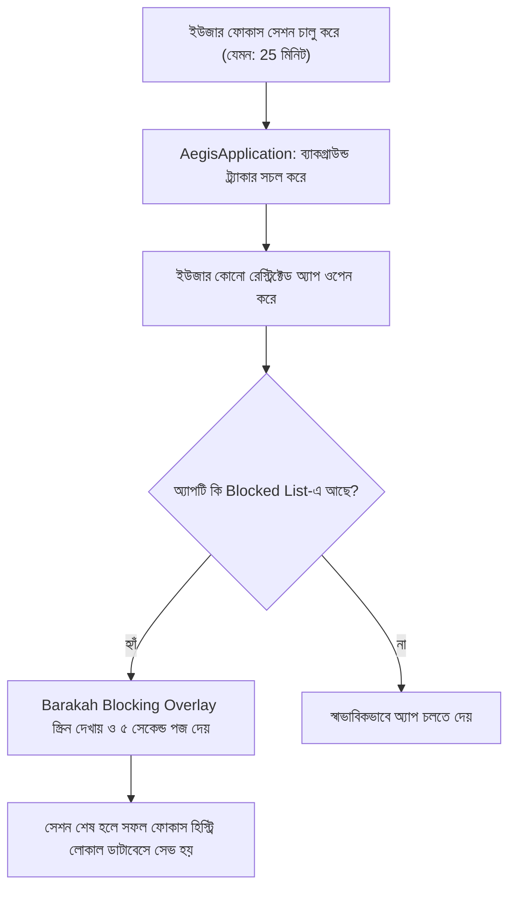

# 🛡️ Barakah — সম্পূর্ণ কোডবেজ গাইড ও বিশ্লেষণ (Code Guide)

স্বাগতম! এই গাইডটি **Barakah** প্রোডাক্টিভিটি স্যুট এবং অ্যান্ড্রয়েড অ্যাপের সমস্ত আর্কিটেকচার, ব্যাকগ্রাউন্ড সার্ভিস ও ব্লকিং মেকানিজম সহজে বোঝার জন্য তৈরি করা হয়েছে।

---

## 🗺️ ১. আর্কিটেকচার ও ফাইল মানচিত্র (File & Architecture Map)

| ফাইল পাথ | মূল ভূমিকা | কী কাজ করে? |
| :--- | :--- | :--- |
| [`index.html`](file:///Users/khalidabdullah/AntiGravity/aegis-focus/index.html) | **ওয়েব ল্যান্ডিং পেজ** | Barakah ফিলোসফি ও ব্র্যান্ড শোকেস (Protect Your Time. Multiply Barakah.)। |
| [`AegisApplication.kt`](file:///Users/khalidabdullah/AntiGravity/aegis-focus/app/src/main/java/com/aegisfocus/app/AegisApplication.kt) | **অ্যাপ এন্ট্রি পয়েন্ট** | নোটিফিকেশন চ্যানেল তৈরি ও ব্যাকগ্রাউন্ড `WorkManager` শুরু করে। |
| [`OnboardingScreen.kt`](file:///Users/khalidabdullah/AntiGravity/aegis-focus/app/src/main/java/com/aegisfocus/app/presentation/onboarding/OnboardingScreen.kt) | **ম্যান্ডেটরি পারমিশন গেট** | Usage Access, Accessibility ও Notification ছাড়া ড্যাশবোর্ডে প্রবেশ আটকায়। |
| [`AegisNavHost.kt`](file:///Users/khalidabdullah/AntiGravity/aegis-focus/app/src/main/java/com/aegisfocus/app/core/navigation/AegisNavHost.kt) | **UI নেভিগেশন গ্রাফ** | Home, Focus, Apps, Stats এবং Settings স্ক্রিনের রাউটিং নিয়ন্ত্রণ করে। |
| [`AegisDatabase.kt`](file:///Users/khalidabdullah/AntiGravity/aegis-focus/app/src/main/java/com/aegisfocus/app/data/local/AegisDatabase.kt) | **১০০% লোকাল ডাটাবেস (Room)** | ব্লকড অ্যাপস তালিকা, সেশন ও ডিসিপ্লিন হিস্ট্রি ডিভাইস মেমরিতে সংরক্ষণ করে। |

---

## 🔄 ২. ব্লকিং ও ফোকাস সেশনের ওয়ার্কফ্লো (Focus Lifecycle)

---

## 🔍 ৩. গুরুত্বপূর্ণ কম্পোনেন্ট বিশ্লেষণ (Core Components Deep Dive)

### ক. `AegisApplication.kt`
- 📌 **উদ্দেশ্য:** অ্যাপ ওপেন হওয়ার সাথে সাথে গ্লোবাল ইনিশিয়ালাইজেশন নিশ্চিত করা।
- ⚙️ **লজিক ফ্লো:**
  1. `AppContainer` ইনিশিয়ালাইজ করে ডিপেন্ডেন্সি ইনজেকশন নিশ্চিত করে।
  2. হাই-প্রায়োরিটি নোটিফিকেশন চ্যানেল তৈরি করে (যাতে ফোকাস চলাকালে টাইমার দেখা যায়)।
  3. `DailyUsageSnapshotWorker` এবং `ScheduleCheckWorker` ব্যাকগ্রাউন্ড টাস্ক শিডিউল করে।

### খ. সার্ভার-সাইড লাইসেন্স কী (Supabase)
- 📌 **উদ্দেশ্য:** প্রতিটি লাইসেন্স কী শুধু একবার ব্যবহারযোগ্য, সবকিছু সার্ভারে যাচাই হয়।
- ⚙️ **লজিক:**
  - কী তৈরি: `admin_generate_license_key` (শুধু `super_admin`), ফরম্যাট `AEGIS-XXXX-XXXX-XXXX-XXXX`
  - কী ব্যবহার: `redeem_license_key` (একবারই কাজ করে, ভুল চেষ্টায় লক হয়)
  - অ্যাপে কোনো মাস্টার পাসওয়ার্ড বা সিক্রেট নেই; অ্যাডমিন প্যানেল শুধু অ্যাডমিন অ্যাকাউন্টে দেখায়।

---

## 🛠️ ৪. কীভাবে টেস্ট ও বিল্ড করবেন (Build & Test)
১. টার্মিনালে `./gradlew test` চালিয়ে সব ইউনিট টেস্ট যাচাই করুন।  
২. `./gradlew assembleRelease` চালিয়ে সাইন করা প্রোডাকশন APK তৈরি করুন।  
৩. ল্যান্ডিং পেজ দেখতে `index.html` যেকোনো ব্রাউজারে খুলুন।
